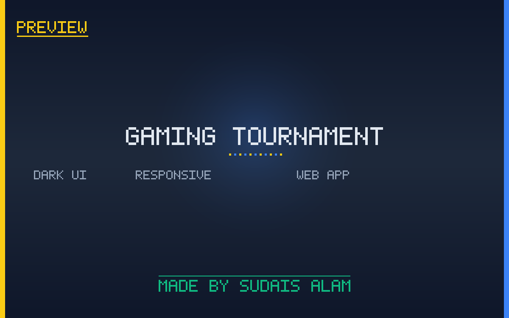

# Gaming Tournament App

A complete, mobile-first **gaming tournament management platform** built with plain HTML, CSS, JavaScript, and **Firebase**. It ships with separate user and admin front-ends, a built-in giveaway system, and a 500+ theme switcher so organizers can re-skin the entire app in seconds.



---

## Features

- **User Front-End (`user.html`)**
  - Mobile-first dark UI built on Bootstrap 5.3 + Swiper sliders.
  - Browse active tournaments, register, and track match status.
  - Player wallet, referral codes, and profile management.
  - Firebase Authentication (email/password + secure rules).

- **Admin Front-Ends (`admin 1.html`, `admin 2.html`)**
  - Off-canvas dashboard with sidebar navigation.
  - Create/edit tournaments & games, manage registered players.
  - Promotions management and analytics overview.

- **Giveaway Module**
  - `giveaway admin.html` — create weekly giveaways & pick winners.
  - `giveaway user.html` — users join the weekly winner draw.

- **Theme Engine**
  - `only theme changer.html` — live theme switcher.
  - `theme colour code.txt` — 500+ curated color palettes (hex codes).

- **Firebase Backend**
  - Realtime Database with role-based security rules (see `firebase realtime rules.txt`).
  - Authentication, Firestore, and Hosting ready to plug in.

---

## Tech Stack

| Layer        | Technology |
|--------------|------------|
| Markup       | HTML5 |
| Styling      | Bootstrap 5.3, custom CSS variables |
| Icons/Fonts  | Bootstrap Icons, Font Awesome 6, Poppins |
| Sliders      | Swiper.js 11 |
| Backend      | Firebase (Realtime DB, Auth, Firestore, Hosting) |
| Deployment   | Any static host (InfinityFree, Netlify, Firebase Hosting) or wrapped as an Android app via HopWeb |

---

## Project Structure

```
Complete Gaming Tournament.zip
├── user.html                  # Main user-facing app
├── admin 1.html                # Admin dashboard (variant 1)
├── admin 2.html                # Admin dashboard (variant 2)
├── giveaway admin.html         # Giveaway management
├── giveaway user.html          # Giveaway entry page
├── only theme changer.html     # Live theme switcher
├── theme colour code.txt       # 500+ theme color palettes
├── firebase realtime rules.txt # Firebase security rules
└── instructions or support.txt # Setup & deployment guide
```

---

## Getting Started

Open `user.html` directly in a browser, or follow the [SETUP.md](SETUP.md) for Firebase configuration and hosting/deployment instructions.

---

## Documentation

- [SETUP.md](SETUP.md) — installation, Firebase setup, and deployment guide.

---

## Credits

Made by **Sudais Alam**.
